# termboy

**Aberturas animadas de jogos retrô no seu terminal**, no estilo Game Boy e Game Boy Advance. Rode `termboy` e assista, como um asciiquarium dos portáteis. Ou rode `termboy jogar` e jogue: quatro das aberturas viram jogos de verdade.

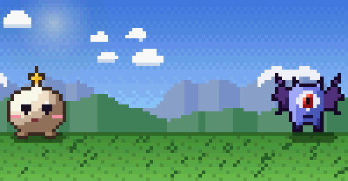

Tudo é desenhado em tempo real com caracteres coloridos, sem vídeo e sem imagens: um arquivo Python, zero dependências.

## Instalação

Com uma linha:

```bash
mkdir -p ~/.local/bin && curl -fsSL https://raw.githubusercontent.com/Nicolas-Queiroz/termboy/main/termboy -o ~/.local/bin/termboy && chmod +x ~/.local/bin/termboy
```

Ou clonando o repositório:

```bash
git clone https://github.com/Nicolas-Queiroz/termboy.git
cd termboy
bash install.sh
```

Precisa de Python 3 e de um terminal com suporte a *true color* (a maioria dos terminais modernos no Linux e no macOS; no Windows, use o Windows Terminal com WSL).

## Uso

```bash
termboy                # todas as aberturas em sequência aleatória
termboy turbo          # só uma, em loop
termboy -e gb          # no estilo do Game Boy original
termboy -e aleatorio   # estilo sorteado a cada abertura
termboy -u             # toca uma vez e sai
termboy -l             # lista as opções
termboy jogar          # modo jogo (tab troca de jogo na tela de título)
termboy jogar gato     # direto num jogo: gato, tocha, turbo ou astro
```

| Tecla | Ação |
|---|---|
| `q` ou `Esc` | sair |
| `espaço` ou `→` | pular para a próxima |
| `e` | trocar o estilo (GB → GBC → GBA) |

Dica: quanto menor a fonte do terminal, mais "pixels" e mais detalhe. Experimente `Ctrl -` algumas vezes antes de rodar.

## Os jogos

Em `termboy jogar`, a abertura de cada jogo vira a tela de título: o PRESS START passa a valer. Sem ninguém apertar nada, as aberturas se revezam, como num fliperama em modo atração.

| | |
|---|---|
| 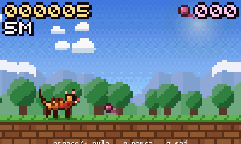 **Pulo do Gato** (`gato`): corredor de um botão só. Pule buracos e caixas, junte novelos; a cada 500 m o dia vira pôr do sol, noite e aurora | 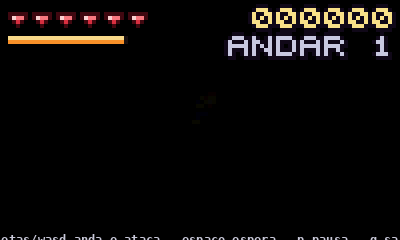 **Tocha Eterna** (`tocha`): roguelike por turnos. A tocha ilumina pouco e gasta óleo a cada passo; quando ela apaga, você não vê mais os monstros |
| 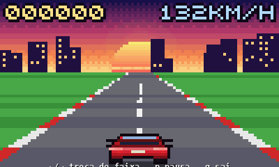 **Turbo Asfalto** (`turbo`): três faixas na pista pseudo-3D. Ultrapasse sem bater; a velocidade só aumenta | 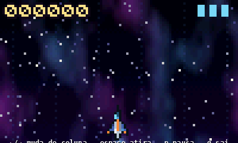 **Astro Vértice** (`astro`): nave em cinco colunas contra drones e rochas. Rocha não morre com tiro: desvie |

### Controles

| Tecla | Ação |
|---|---|
| `enter` ou `espaço` | começar (na tela de título) |
| `espaço`, `↑` ou `w` | pular (Pulo do Gato) |
| `espaço` | atirar (Astro Vértice), esperar um turno (Tocha Eterna) |
| setas ou `wasd` | andar e atacar esbarrando (Tocha Eterna), trocar de faixa ou coluna (Turbo, Astro) |
| `p` ou `Esc` | pausar |
| `tab` | outro jogo (na tela de título) |
| `e` | trocar o estilo de cor |
| `q` | sair |

Os recordes ficam em `~/.local/share/termboy/recordes.json` (ou em `$XDG_DATA_HOME`). O jogo precisa de pelo menos 80×24; num terminal menor ele pausa e pede para aumentar.

Para gravar e rever uma partida: `termboy jogar gato --gravar partida.json` e depois `termboy jogar --replay partida.json`. A mesma semente (`--semente 42`) dá sempre a mesma fase.

### Compatibilidade de terminais

O termboy pergunta ao terminal se ele suporta o [protocolo de teclado do kitty](https://sw.kovidgoyal.net/kitty/keyboard-protocol/), que avisa quando uma tecla é solta. Com ele, segurar o pulo no Pulo do Gato dá um pulo mais alto. Sem ele, todo pulo tem a mesma altura, e os quatro jogos continuam jogáveis do mesmo jeito.

| Terminal | Eventos de soltar tecla |
|---|---|
| kitty, foot, Ghostty, WezTerm¹ | sim |
| GNOME Terminal e outros baseados em VTE | não |
| tmux | não (o tmux não repassa esses eventos) |
| zellij, Alacritty, iTerm2, Konsole, Windows Terminal | confira com `termboy --teclado` |

¹ No WezTerm, ative `enable_kitty_keyboard = true` na configuração.

`termboy --teclado` mostra o modo detectado e cada evento que chega, útil para conferir dentro de um multiplexador.

## As aberturas

| | |
|---|---|
| 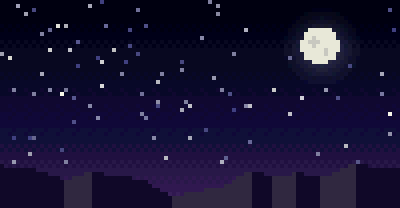 **Elementra** (`elementra`): duas criaturas se enfrentam numa batalha, com estrela cadente, ataque de energia e título no pôr do sol | 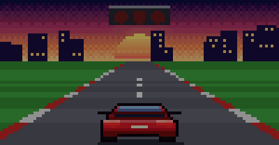 **Turbo Asfalto** (`turbo`): largada com semáforo, pista em pseudo-3D, ultrapassagem, nitro e horizonte neon |
| 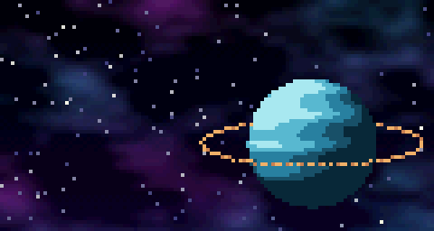 **Astro Vértice** (`astro`): nave contra drones numa nebulosa, asteroide e um chefe gigante chegando | 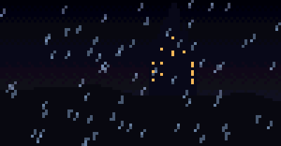 **Reino de Cinza** (`reino`): tempestade sobre o castelo, cavaleiro, dragão cruzando a lua e título em chamas |
| 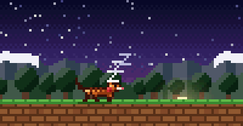 **Pulo do Gato** (`gato`): amanhecer nas colinas, o gato Pipoca correndo entre buracos e novelos | 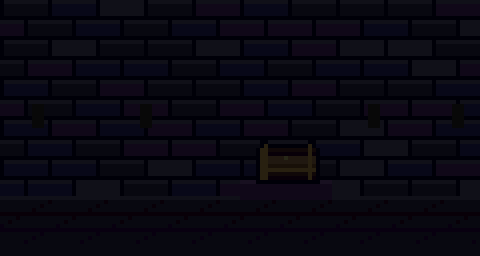 **Tocha Eterna** (`tocha`): uma tocha acende no escuro, o mago Nox encontra um baú e um cristal azul |

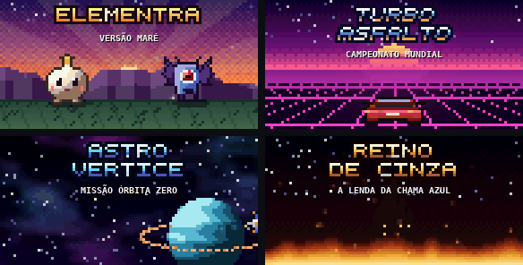

## O elenco

Todos os personagens são desenhados por código, com sombreamento no estilo dos sprites de GBA.

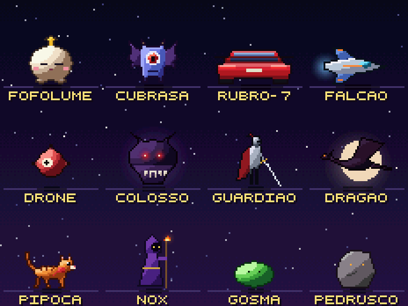

## Três estilos de cor

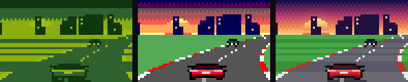

- `gb`: os quatro tons de verde da tela do Game Boy original
- `gbc`: a paleta limitada do Game Boy Color
- `gba`: cores de 15 bits, como no Game Boy Advance

## Usar num painel

O termboy funciona bem num canto da tela, dentro do tmux ou do zellij. No zellij:

```kdl
pane command="termboy" {
    args "-e" "aleatorio"
}
```

E uma aba para jogar, num layout do zellij:

```kdl
tab name="jogar" {
    pane command="termboy" {
        args "jogar"
    }
}
```

## Criar uma abertura nova

Cada abertura é uma função `minha_abertura(tela, t)` que desenha o quadro do instante `t` (em segundos). O motor oferece:

- `tela.ceu()`, `tela.retangulo()`, `tela.circulo()`, `tela.poligono()`, `tela.brilho()`, `tela.flash()`
- `Spr`: sprites com sombreamento automático (`elipse`, `poligono`, `contorno`)
- `titulo()` e `rodape()`: título em pixel art com contorno e brilho, mais o "PRESS START"

Registre a função no dicionário `ABERTURAS` e gere os GIFs de demonstração:

```bash
pip install pillow
python3 tools/gerar_gifs.py            # todos, ou só alguns: aberturas titulos jogos ...
```

Um jogo é uma subclasse de `Jogo` (`iniciar`, `atualizar`, `desenhar`, `pontos`) registrada em `JOGOS`. A lógica roda em passo fixo de 30 Hz e usa só o `random.Random` do próprio jogo, então a mesma semente com as mesmas teclas repete a partida: é assim que os GIFs dos jogos são feitos, a partir de replays jogados por bots (`tools/bots.py`, `tools/gravar_replays.py`).

Os testes ficam em `tests/` e não precisam de nada além do Python:

```bash
python3 -m unittest discover -s tests -v
```

PRs com aberturas e jogos novos são bem-vindos!

## Desinstalar

```bash
rm ~/.local/bin/termboy
```

## Licença

[MIT](LICENSE). As aberturas, personagens, nomes e cenários são originais deste projeto.
